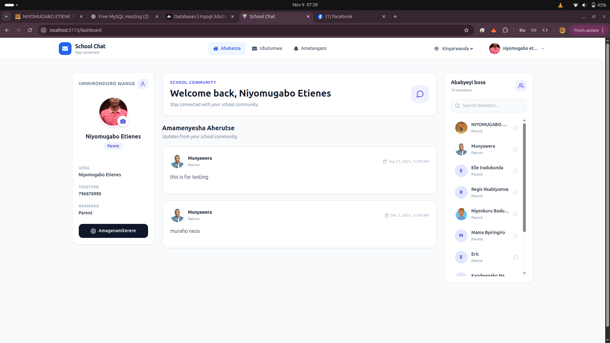
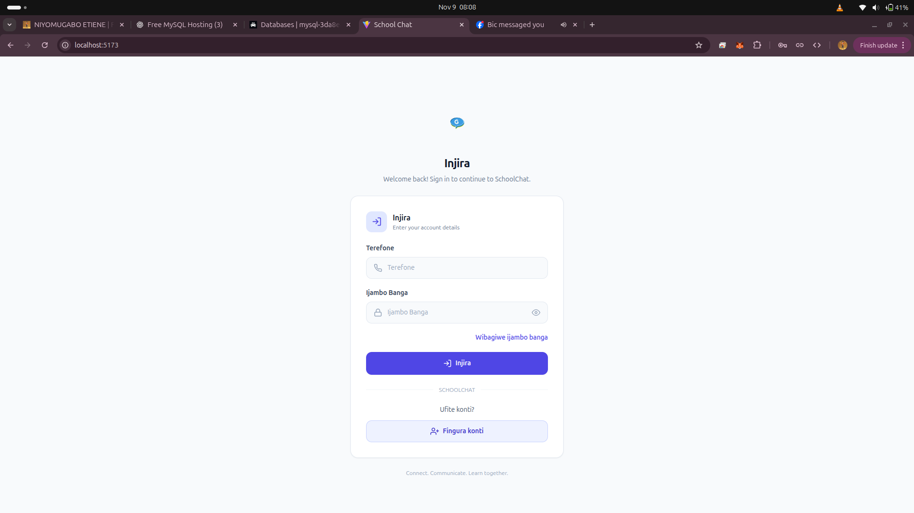
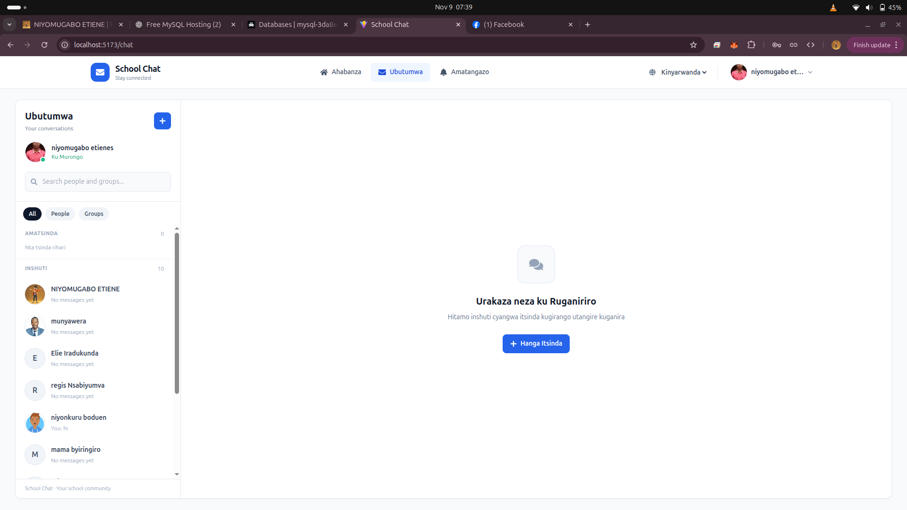
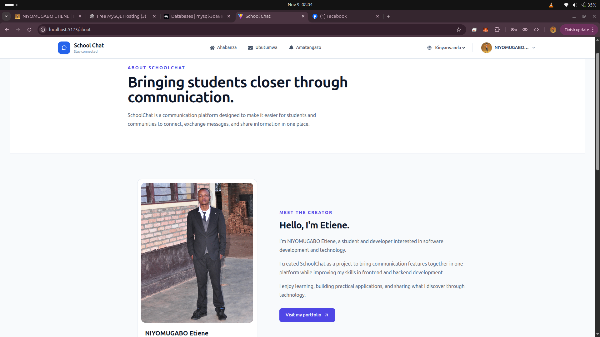

# SchoolChat – A Platform for Student Communication

<p align="center">
  
</p>

<p align="center">
  <strong>Connect. Communicate. Share.</strong>
</p>

<p align="center">
  A web-based communication platform designed to bring students and communities together.
</p>

<p align="center">
  <a href="https://niyomugaboetiene.vercel.app">Developer Portfolio</a>
</p>

---

## Table of Contents

- [Overview](#overview)
- [Application Screenshots](#application-screenshots)
- [Features](#features)
- [Technology Stack](#technology-stack)
- [How SchoolChat Works](#how-schoolchat-works)
- [Project Structure](#project-structure)
- [Installation and Setup](#installation-and-setup)
- [Environment Configuration](#environment-configuration)
- [Database Setup](#database-setup)
- [Future Improvements](#future-improvements)
- [Developer](#developer)
- [License](#license)

---

## Overview

**SchoolChat** is a web-based communication application developed to make communication and interaction easier among students and communities.

The platform provides users with features for sending messages, creating groups, managing group members, sharing posts, viewing profiles, and receiving notifications.

The project focuses on combining frontend development, backend API integration, database management, and real-time communication into one practical application.

---

## Application Screenshots

Explore the SchoolChat interface below. Click any screenshot to view it in full size.

### 1. Login Page

Users can access their accounts using their registered phone numbers and passwords.

[](screenshots/login.png)

### 2. Dashboard

The dashboard provides access to posts and community activities.

[](screenshots/dashboard.png)

### 4. Chat Interface

Users can communicate and exchange messages through the chat interface.

[](screenshots/chat.png)

### 5. About Developer

Learn more about the developer behind SchoolChat.

[](screenshots/about.png)

---

## Features

### User Authentication
- User registration.
- User login using phone number and password.
- Password hashing on the backend.

### Communication
- Real-time messaging.
- Individual user conversations.
- Group conversations.

### Group Management
- Create new groups.
- Add group members.
- Remove group members.
- Change group names.
- Update group profile photos.

### Posts and Profiles
- View posts on the dashboard.
- Open individual post details.
- View user profiles.

### Notifications
- Receive notifications.
- View notification details.
- Mark notifications as read.
- Navigate to related activities.

### User Interface
- Responsive design.
- Organized navigation.
- Clean and accessible interface.

---

## Technology Stack

SchoolChat uses the following technologies:

| Technology | Description |
|---|---|
| React.js | Building the frontend interface |
| Tailwind CSS | Styling and responsive layouts |
| Node.js | JavaScript backend runtime |
| Express.js | Backend API development |
| MySQL | Relational database management |
| Socket.IO | Real-time communication |
| Axios | HTTP requests between frontend and backend |
| React Router | Client-side navigation |
| React Icons | Interface icons |
| bcrypt | Password hashing |

---

## How SchoolChat Works

The application follows a client-server architecture.

1. Users interact with the React frontend.
2. The frontend communicates with the backend through HTTP requests.
3. Express.js handles API requests and application logic.
4. MySQL stores application data.
5. Socket.IO supports real-time communication between connected users.
6. The backend returns data to the frontend for display.

---

## Project Structure

```text
SchoolChat/
│
├── Chat-app-frontend-main/
│   ├── public/
│   ├── src/
│   │   ├── assets/
│   │   ├── pages/
│   │   ├── api.js
│   │   ├── App.jsx
│   │   └── main.jsx
│   └── package.json
│
├── gikonko-chat-backend/
│   ├── routes/
│   ├── controllers/
│   ├── models/
│   ├── db.js
│   ├── server.js
│   └── package.json
│
├── screenshots/
│   ├── login.png
│   ├── dashboard.png
│   ├── chat.png
│   └── about.png
│
└── README.md
```

*Adjust the example structure to match your actual repository.*

---

## Installation and Setup

Follow these instructions to run SchoolChat locally.

### Prerequisites

Install the following tools:

- [Node.js](https://nodejs.org/)
- [npm](https://www.npmjs.com/)
- [MySQL](https://www.mysql.com/)
- [Git](https://git-scm.com/)

### Step 1: Clone the Repository

```bash
git clone https://github.com/niyomugaboetiene/SchoolChat.git
```

```bash
cd chat-app
```

### Step 2: Install Backend Dependencies

```bash
cd Chat-app-backend-main

```bash
cd gikonko-chat-backend

npm install
```

### Step 3: Configure the Database

Create a MySQL database and configure the database connection using your project's database configuration.

### Step 4: Start the Backend

```bash
npm start
```

### Step 5: Install Frontend Dependencies

Open another terminal:

```bash
cd Chat-app-frontend-main
npm install
```

### Step 6: Start the Frontend

```bash
npm run dev
```

Open the local development URL displayed in your terminal.

---

## Environment Configuration

Configure the environment variables required by your backend and frontend.

Example backend configuration:

```env
DB_HOST=localhost
DB_USER=root
DB_PASSWORD=your_password
DB_NAME=schoolchat
PORT=4000
```

Example frontend configuration:

```env
VITE_REACT_BACKEND_API=http://localhost:4000
```

Use the variable names expected by your actual application. Never commit real passwords, database credentials, or private API keys to GitHub.

---

## Database Setup

SchoolChat uses MySQL as its relational database.

The database is responsible for storing application information such as:

- User accounts.
- Group information.
- Group members.
- Messages.
- Posts.
- Notifications.

Ensure that the required database tables are created before running the application.

---

## Future Improvements

Potential improvements for future versions include:

- Voice and video calling.
- File and document sharing.
- Advanced message search.
- Improved notification preferences.
- Enhanced account security.
- More group collaboration features.

---

## Developer

<p align="center">
  
</p>

<h3 align="center">NIYOMUGABO Etiene</h3>

<p align="center">
  UR Student | Software Developer | Technology Enthusiast | AI Developer
</p>

I am interested in software development, web technologies, and building practical applications that solve real-world problems.

SchoolChat is one of my projects, developed to strengthen my skills in frontend development, backend engineering, database management, and real-time communication.

**Portfolio:** [https://niyomugaboetiene.vercel.app](https://niyomugaboetiene.vercel.app)

---

## License

This project is intended for educational and personal development purposes. Please contact the developer for permission before redistributing or using it commercially.

---

<p align="center">
  **Built with dedication by NIYOMUGABO Etiene.**
</p>

<p align="center">
  Thank you for checking out SchoolChat!
</p>